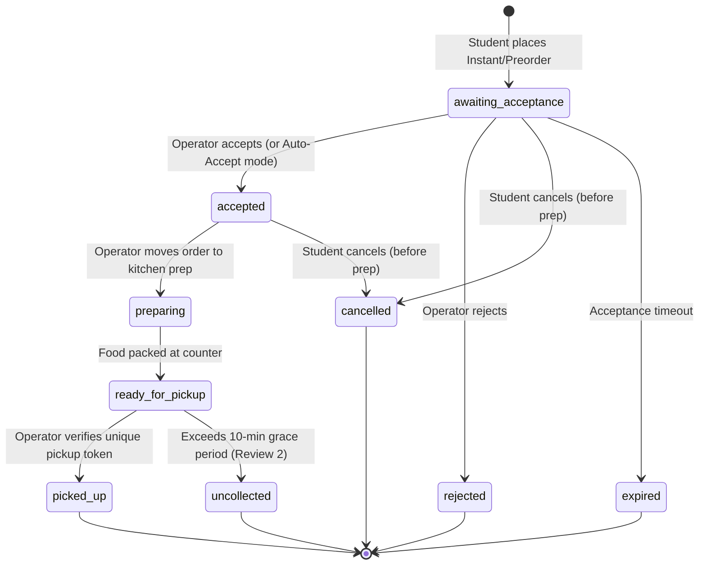

# MU Canteen — Architecture Documentation (Review 1)

## 1. High-Level System Architecture

MU Canteen is a centralized campus canteen mobile application designed for **Marwadi University, Rajkot**. It adheres to a strict separation of concerns, modular Model-View-Controller (MVC) architecture, and role-oriented presentation for four primary roles:
- **Student**
- **Faculty / Staff**
- **Canteen Operator**
- **College Administrator**

```
MU Canteen/
├── frontend/                     # Pure React Native Mobile Application
│   ├── assets/                   # App icons, splash screens, visual branding
│   ├── src/
│   │   ├── config/               # Firebase client config & environment loaders
│   │   ├── theme/                # MU design system (University Teal #079FA7, Charcoal)
│   │   ├── models/               # Strongly typed data models (User, Campus, Menu, Order, Settings)
│   │   ├── services/             # Business services & persistence
│   │   │   ├── firebase/         # Live Firestore & Auth client services
│   │   │   ├── demo/             # Complete campus seed data & local storage engine
│   │   │   └── serviceProvider.ts # Dual-mode dispatcher (Live vs Zero-setup Demo)
│   │   ├── context/              # AuthContext, CartContext, CampusContext
│   │   ├── navigation/           # React Navigation role navigators & protected stacks
│   │   ├── components/           # Reusable UI cards, inputs, buttons, badges, modals
│   │   ├── views/                # Role-oriented screens (Student, Operator, Admin, Auth)
│   │   └── utils/                # Token generation, idempotency guards, INR formatters
│   ├── tests/                    # Frontend unit tests
│   └── package.json
├── backend/                      # Firebase Backend Resources & Cloud Functions
│   ├── firestore.rules           # Production-grade Firestore Security Rules
│   ├── firestore.indexes.json    # Composite query indexes
│   ├── firebase.json             # Firebase configuration & emulator ports
│   ├── functions/                # Cloud Functions for trusted server execution
│   │   └── src/index.ts          # createOrderSecure, verifyPickupTokenSecure, cancelOrderSecure
│   ├── scripts/                  # Standalone database seeding script
│   └── tests/                    # Backend security & state machine unit tests
└── docs/                         # Guides & documentation
```

---

## 2. Order State Machine



### Cancellation Policy
- **Student cancellation is permitted ONLY before kitchen preparation begins** (i.e. in `awaiting_acceptance` or `accepted` status).
- Once an order enters `preparing`, `ready_for_pickup`, or `picked_up`, cancellation is locked by the client UI, trusted backend functions, and Firestore security rules.

### Pickup Token Verification
- Orders generate a unique verification token (e.g. `MU-4892`).
- The operator views or scans the token at the counter.
- Duplicate pickup attempts are immediately rejected; an order can never be collected twice.

---

## 3. Review 1 vs Review 2 Boundaries

| Feature Area | Review 1 (Implemented Now) | Review 2 (Upcoming Milestone) |
| :--- | :--- | :--- |
| **Ordering** | Instant & Scheduled Preorders with slot selection | Automated wait-time forecasting & queue heatmaps |
| **Pickup Policy** | 10-minute grace period policy acceptance modal | Automated timer expiry & auto-uncollected processing |
| **Surplus Food** | UI placeholder / teaser for flash sales | 50%-off surplus flash sale listings with atomic concurrency |
| **Payments** | Simulated UPI, Simulated Card, and Cash at Counter | Production Razorpay / Cashfree gateway integration |
| **Late Fees** | Documented ₹10 late fee policy in agreement | Automated deduction of ₹10 late fee upon grace period expiry |
| **Notifications** | In-app real-time pipeline status updates | Firebase Cloud Messaging (FCM) background push notifications |

