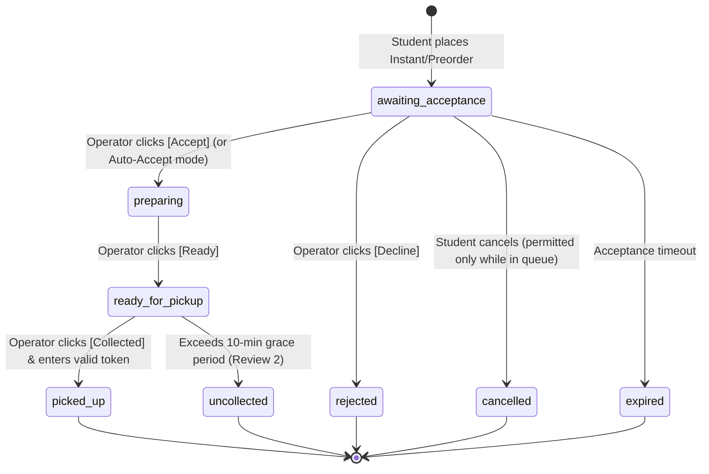

# MU Canteen — Architecture Documentation (Review 1)

## 1. High-Level System Architecture

MU Canteen is a centralized campus canteen mobile application designed for **Marwadi University, Rajkot**. It adheres to a strict separation of concerns, modular Model-View-Controller (MVC) architecture, and role-oriented presentation for four primary roles:
- **Student**
- **Faculty / Staff**
- **Canteen Operator**
- **College Administrator**

```
MU Canteen/
├── frontend/                     # Pure React Native Mobile Application (Expo SDK 58, React 19)
│   ├── assets/                   # App icons, splash screens, visual branding
│   ├── src/
│   │   ├── config/               # Firebase client config & environment loaders
│   │   ├── theme/                # MU design system (University Teal #079FA7, Charcoal #1E293B)
│   │   ├── models/               # Strongly typed data models (User, Campus, Menu, Order, Settings)
│   │   ├── services/             # Business services & persistence
│   │   │   ├── firebase/         # Live Firestore & Auth client services
│   │   │   ├── demo/             # Complete campus seed data & local storage engine
│   │   │   └── serviceProvider.ts # Dual-mode dispatcher (Live vs Zero-setup Demo)
│   │   ├── context/              # AuthContext, CartContext, CampusContext
│   │   ├── navigation/           # React Navigation role navigators & protected stacks
│   │   ├── components/           # Reusable UI cards, inputs, buttons, badges, modals, CompactNavGrid
│   │   ├── views/                # Role-oriented screens (Student, Operator, Admin, Auth)
│   │   └── utils/                # Token generation, idempotency guards, INR formatters
│   ├── tests/                    # Frontend unit tests (businessLogic.test.mjs)
│   ├── eas.json                  # Standalone APK build configuration
│   └── package.json
├── backend/                      # Firebase Backend Resources & Cloud Functions
│   ├── firestore.rules           # Production-grade Firestore Security Rules
│   ├── firestore.indexes.json    # Composite query indexes
│   ├── firebase.json             # Firebase configuration & emulator ports
│   ├── functions/                # Cloud Functions for trusted server execution
│   │   └── src/index.ts          # createOrderSecure, verifyPickupTokenSecure, cancelOrderSecure
│   ├── scripts/                  # Standalone canonical campus seeding script (seedData.ts)
│   └── tests/                    # Backend security & state machine unit tests (securityAndFunctions.test.mjs)
└── docs/                         # Guides, architecture & evaluation instructions
```

---

## 2. Order State Machine & Operator Queue Workflow

The Canteen Operator Order Queue strictly enforces a predictable, sequential linear workflow:
`Accept / Decline → Ready → Collected`



### Exact Operator Queue Button Mapping
1. **In Queue (`awaiting_acceptance`):**
   - Displays only two action buttons: **[Accept]** and **[Decline]**.
   - Tapping **[Accept]** automatically transitions the order directly into `preparing` (eliminating redundant intermediary "Start Preparing" clicks).
   - Tapping **[Decline]** transitions the order to `rejected` and removes it from active processing.
2. **Preparing (`preparing`):**
   - Displays only **[Ready]**.
   - Tapping **[Ready]** transitions the order to `ready_for_pickup`.
3. **Ready (`ready_for_pickup`):**
   - Displays only **[Collected]**.
   - Tapping **[Collected]** opens the pickup verification dialog. Once the student's unique 4-character pickup token (e.g. `MU-4892`) is entered or verified, the order transitions to `picked_up`.

### Automatic Acceptance Mode
For canteens configured with `autoAcceptOrders: true`, orders bypass the initial pending queue and start immediately in `preparing`.

### Cancellation Invariants
- **Student cancellation is permitted ONLY while an order is in `awaiting_acceptance`**.
- As soon as the operator accepts the order (or under auto-acceptance), the order enters `preparing`, locking cancellation across the client UI, trusted backend functions, and Firestore security rules.

---

## 3. Preorder Policy Agreement Flow

When a student selects **Preorder** during checkout:
1. The app displays the **Marwadi University Preorder & Grace Period Policy Modal**.
2. **Mandatory Acceptance Checkbox**: "I understand that preordered food will be discarded after 10 minutes past pickup time, and a ₹10 fee may apply."
3. The **[Accept & Continue]** button remains strictly disabled until the checkbox is checked.
4. **Declining the Policy**: If the student taps **[Decline]**, the app immediately reverts the order to an **Instant Order** without reserving a time slot.

---

## 4. Campus Layout & Canteens (10 Configured Venues)

1. **Main Academic Building (MB)**:
   - MB Ground Floor: Stationery, Tea & Quick Bites
   - MB Floor 1: Central Campus Food Court
   - MB Floor 2: Sandwich, Shake & Juice Corner
   - MB Floor 3: Faculty Executive Lounge *(Access restricted to faculty & staff)*
   - MB Floor 4: South Indian Delights & Snacks
   - MB Floor 5: Bakehouse & Dessert Bar
   - MB Floor 6: Skyline Rooftop Cafe
   - MB West Wing Annex: Express Tea & Coffee Bar
   - MB East Wing Atrium: Healthy Salad & Fresh Juice Bar
2. **Faculty of Law Building (LAW)**:
   - Law Building Canteen (Ground Floor)
3. **Campus Hostel Block A (HSTL)**:
   - Hostel Mess Point (Ground Floor Dining Hall)

---

## 5. Review 1 vs Review 2 Boundaries

| Feature Area | Review 1 (Implemented Now) | Review 2 (Upcoming Milestone) |
| :--- | :--- | :--- |
| **Ordering** | Instant & Scheduled Preorders with slot selection | Automated wait-time forecasting & queue heatmaps |
| **Pickup Policy** | 10-minute grace period policy acceptance modal | Automated timer expiry & auto-uncollected processing |
| **Surplus Food** | UI placeholder / teaser for flash sales | 50%-off surplus flash sale listings with atomic concurrency |
| **Payments** | Simulated UPI, Simulated Card, and Cash at Counter | Production Razorpay / Cashfree gateway integration |
| **Late Fees** | Documented ₹10 late fee policy in agreement | Automated deduction of ₹10 late fee upon grace period expiry |
| **Notifications** | In-app real-time pipeline status updates | Firebase Cloud Messaging (FCM) background push notifications |
